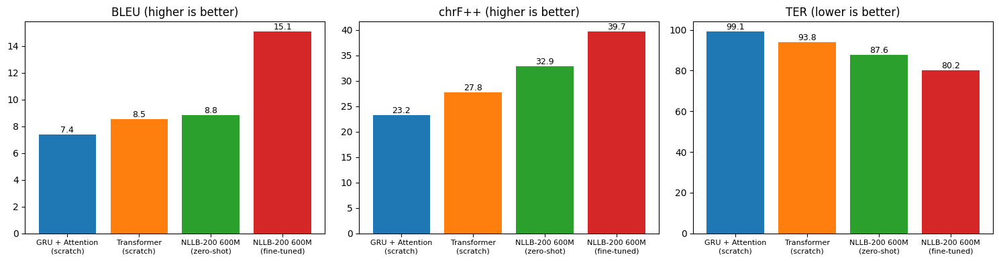
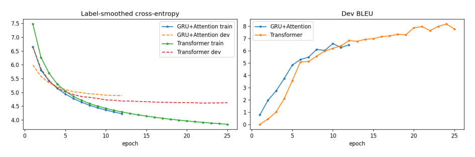
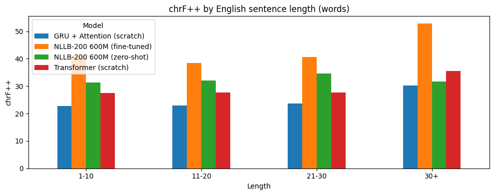

# English → Assamese Neural Machine Translation (Low-Resource NMT)

A mini project for the Computational Linguistics & NLP course. It builds and compares four neural machine translation systems for **English → Assamese**, a low-resource Indic language pair. Training data comes from the **WMT 2026 Shared Task on Low-Resource Indic Language Translation**.

| # | Model | Type |
|---|-------|------|
| 1 | Bi-GRU encoder–decoder with Bahdanau attention | trained from scratch |
| 2 | Transformer encoder–decoder | trained from scratch |
| 3 | NLLB-200 distilled 600M | pre-trained, zero-shot |
| 4 | NLLB-200 distilled 600M | pre-trained, fine-tuned on WMT data |

**Best result:** fine-tuned NLLB-200, with **15.08 BLEU / 39.67 chrF++** on a 1,000-sentence held-out test set.

---

## Project structure

```
CLNLP_EXP-10/
├── data.py          # settings, cleaning, splitting, SentencePiece tokenisation  (python data.py)
├── models.py        # GRU + attention, Transformer, NLLB-200 helpers
├── train.py         # trains a model and translates the test set              (python train.py --model ...)
├── evaluate.py      # BLEU / chrF++ / TER, plots, translate your own sentences (python evaluate.py)
├── data/raw/en_as_wmt2026.csv        # WMT 2026 English–Assamese training data
├── notebooks/
│   ├── run_on_colab.ipynb             # runs the four steps on a Colab GPU
│   └── experiments_with_outputs.ipynb # original end-to-end experiment notebook with all outputs
├── results/         # results.csv and figures from the final run
└── requirements.txt
```

The scripts create two folders that are not tracked by git:
- `outputs/` holds checkpoints, tokenisers and test-set predictions.
- `data/processed/` holds the train/dev/test splits.

---

## 1. Dataset

| Item | Details |
|------|---------|
| Source | [WMT 2026 Indic MT Task](https://www2.statmt.org/wmt26/indic-mt-task.html), Category I, English–Assamese |
| Size | 54,000 sentence pairs |
| Domain | mixed: agriculture, government press releases, religious text, general |
| Scripts | English: Latin. Assamese: Bengali–Assamese script |

## 2. Preprocessing (`data.py`)

1. Unicode **NFC normalisation**, plus removal of control and zero-width characters.
2. Whitespace clean-up, and re-attaching detached punctuation (`soil .` → `soil.`).
3. **Length filter:** remove sentences longer than 80 words, and pairs with a length ratio above 3.
4. **Script filter:** keep a pair only if at least 80% of the letters on the Assamese side are in Bengali script.
5. **De-duplication** of pairs and of source sentences.
6. A seeded split into **47,113 train / 1,000 dev / 1,000 test** pairs.

| Step | Pairs |
|------|------:|
| Raw | 54,000 |
| After length filter | 53,203 |
| After script filter | 53,194 |
| After de-duplication | 49,113 |

## 3. Tokenisation (`data.py`)

- A **SentencePiece unigram** model is trained for each language on the training split only, with an 8,000-subword vocabulary.
- Every sentence becomes `<s> subword-ids </s>`, at most 64 tokens long. Only 0.11% of sentences are truncated, and the test-set unknown-token rate is 0%.
- Batches group sentences of similar length together, which keeps padding to a minimum.

## 4. Models (`models.py`, trained by `train.py`)

**GRU + attention** (`Seq2SeqAttn`):
- encoder: embedding (256) followed by a bidirectional GRU (2×256)
- decoder: a GRU with additive (Bahdanau) attention over the encoder states
- 17.9M parameters

**Transformer** (`TransformerMT`):
- 3 encoder and 3 decoder layers, d_model 256, 4 heads, feed-forward size 1024
- pre-LayerNorm, sinusoidal positional encodings and tied output embeddings
- Noam learning-rate schedule with 800 warm-up steps
- 9.6M parameters

**Training setup shared by both scratch models:**
- label-smoothed cross-entropy (ε = 0.1)
- Adam optimiser and gradient clipping
- early stopping on dev BLEU
- greedy decoding

**NLLB-200** (`facebook/nllb-200-distilled-600M`):
- translates with the target language forced to `asm_Beng` and 4-beam search
- fine-tuned for one epoch with Adafactor (lr 1e-4)
- fine-tuning fits on a 15 GB T4 GPU thanks to gradient checkpointing, fp16 mixed precision, and a batch size of 8 with 4 gradient-accumulation steps

## 5. Results

All results are on the 1,000-sentence test set, from a run on a Google Colab T4 GPU.

| Model | Params | BLEU ↑ | chrF++ ↑ | TER ↓ |
|-------|-------:|-------:|---------:|------:|
| GRU + Attention (scratch) | 17.9M | 7.38 | 23.24 | 99.06 |
| Transformer (scratch) | 9.6M | 8.52 | 27.76 | 93.85 |
| NLLB-200 600M (zero-shot) | 615M | 8.82 | 32.94 | 87.61 |
| **NLLB-200 600M (fine-tuned)** | 615M | **15.08** | **39.67** | **80.20** |







### Sample translation

| | |
|---|---|
| **English** | In addition to fertilizer, this plant will produce natural gas, thereby contributing to the country's energy requirements. |
| GRU + Attention | ইয়াৰ জৰিয়তে এই ক্ষেত্ৰত এই ক্ষেত্ৰত ভাৰতৰ শক্তি উৎপাদন বৃদ্ধিৰ বাবে এক বিশেষ সুযোগ গ্রহণ কৰিব। |
| Transformer | ইয়াৰ উপৰিও, ‘একেলগ্র’ৰ জৰিয়তে আমাৰ দেশৰ শক্তি উৎপাদনৰ ক্ষেত্ৰতো যথেষ্ট বৰঙণি আগবঢ়াব। |
| NLLB zero-shot | এই উদ্ভিদে সাৰৰ উপৰিও প্ৰাকৃতিক গেছ উৎপাদন কৰিব, যাৰ ফলত দেশৰ শক্তিৰ চাহিদা পূৰণ হ'ব। |
| NLLB fine-tuned | এই উদ্ভিদে সাৰৰ উপৰিও প্ৰাকৃতিক গেছ উৎপাদন কৰিব আৰু দেশৰ শক্তিৰ চাহিদা পূৰণত সহায় কৰিব। |

### Key findings

- **Transfer learning matters most.** Fine-tuned NLLB is the best model on every metric. That is about 1.8× the BLEU of the best scratch model, and +6.3 BLEU over NLLB zero-shot.
- **Among scratch models, the Transformer beats the GRU** (+1.1 BLEU, +4.5 chrF++) with about half the parameters.
- **chrF++ separates the models better than BLEU** for morphologically rich Assamese. NLLB zero-shot ties the Transformer on BLEU but leads by 5 points on chrF++.
- **The data is noisy.** Some WMT pairs are misaligned; for example, the reference translation for the sentence above describes an airport inauguration.

---

## How to run

### On Google Colab (recommended)

Open [`notebooks/run_on_colab.ipynb`](notebooks/run_on_colab.ipynb) in Colab, select a **T4 GPU**, and run all cells.

### Locally

```bash
pip install -r requirements.txt
```
```bash
python data.py
```
```bash
python train.py --model gru
```
```bash
python train.py --model transformer
```
```bash
python train.py --model nllb --finetune
```
```bash
python evaluate.py
```
```bash
python evaluate.py --translate --model nllb-finetuned "The farmers are growing rice in the field."
```

- The scripts pick CUDA, Apple MPS or CPU automatically.
- NLLB fine-tuning really needs a CUDA GPU. Without one, run `python train.py --model nllb` for zero-shot only.
- Settings live at the top of each file: data and tokeniser settings in `data.py`, model and fine-tuning hyper-parameters in `models.py`. For example, set `FT_MAX_SENTENCES` for a shorter fine-tuning run.

## Future work

- Back-translation of monolingual Assamese text.
- Multilingual training with related languages (Bengali, Manipuri).
- Larger models such as IndicTrans2.
- Beam search and checkpoint averaging for the scratch models.
- Human evaluation of adequacy and fluency.

## Tech stack

Python 3, PyTorch, Hugging Face Transformers, SentencePiece, sacreBLEU, pandas, matplotlib.
